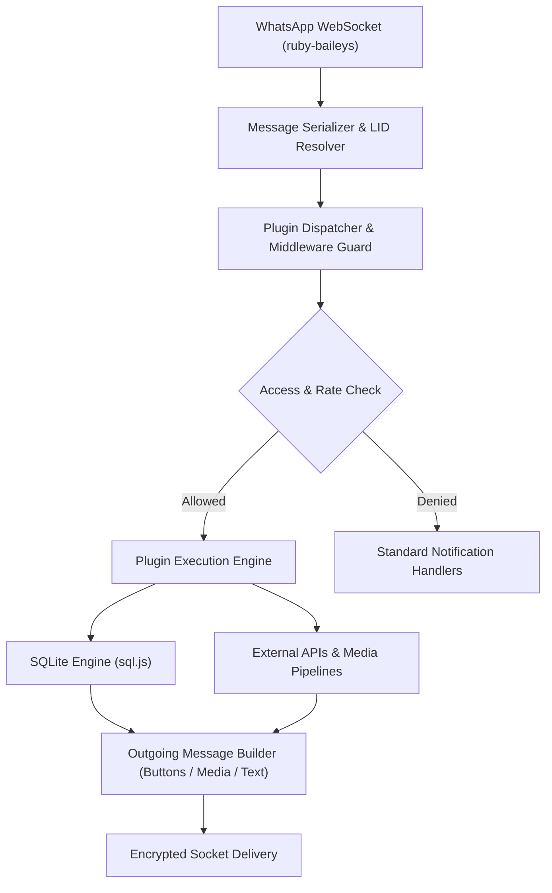

# Rubby Multi-Device

> Enterprise-grade, modular, high-performance WhatsApp automation bot built with pure Node.js ES Modules (ESM) and powered by `ruby-baileys@1.5.17`.

---

## Highlights

- **Pure ES Module Architecture**: Standard modern JavaScript (`"type": "module"`), free from legacy CommonJS wrappers.
- **Embedded SQLite via sql.js**: 100% serverless, zero-external-daemon relational database with WebAssembly runtime and auto-migration capabilities.
- **Dynamic Plugin Hot Reloading**: Add, edit, or remove commands on the fly without restarting the runtime process.
- **LID & JID Resolution Guard**: Robust identity mapping between Phone Numbers and WhatsApp LIDs preventing double-dispatching and authentication mismatches.
- **Multi-Platform Downloader & Automation Suite**: Integrated media pipelines for TikTok, Instagram, YouTube, Facebook, CapCut, GitHub, and more.
- **Live Repository Synchronization**: Real-time update checks against the official GitHub branch with interactive console prompts and remote owner trigger (`.update`).

---

## Technical Specifications

| Component | Technology | Specification / Role |
| :--- | :--- | :--- |
| **Runtime Environment** | Node.js | `>= 18.0.0` (Recommended: Node.js 20.x or 22.x LTS) |
| **Protocol Engine** | `ruby-baileys` | `v1.5.17` — Modern WhatsApp Multi-Device WebSocket Engine |
| **Database Engine** | `sql.js` | `v1.14.0` — In-memory SQLite WebAssembly with persistent file sync |
| **Image & Canvas Processor** | `sharp` | `v0.35.5` — High-throughput SVG/PNG/JPEG vector rendering & image manipulation |
| **Media Stream Processor** | `fluent-ffmpeg` | `v2.1.3` — Audio DSP filter chain and video stream transcoding |
| **HTTP & API Client** | `axios` | `v1.20.0` — Guarded network requests with timeout & buffer handling |
| **Archive Processor** | `adm-zip`, `jszip` | Stream compression, extraction, and GitHub backup dispatch |
| **Parser & Scraper** | `cheerio` | `v1.2.0` — Fast server-side HTML/XML scraping & traversal |
| **Telemetry Logger** | `pino` | `v9.6.0` — High-performance JSON/Stream event logger |

---

## Architecture & Data Flow



---

## Project Structure

```text
Rubby-Multi-Device/
├── main.js                      # Core Application Entry & Lifecycle Orchestrator
├── handler.js                   # Central Message Routing, Access Guard & Dispatcher
├── setting.js                   # Global Configurations, Credentials & API Endpoints
├── package.json                 # Dependency Manifest & Scripts
├── database/
│   └── database.sqlite          # Persistent SQLite Database File (sql.js)
├── lib/
│   ├── database.js              # SQLite Database API & Schema Migrator
│   ├── serializer.js            # Inbound Message Sanitizer & Context Extender
│   ├── plugins.js               # Dynamic Plugin Registry & Hot-Reload Watcher
│   ├── message.js               # Custom Socket Helper Bindings
│   ├── logger.js                # Formatted Telemetry & Event Logger
│   ├── canvas.js                # SVG & Graphic Rendering Pipeline
│   ├── exif.js                  # Sticker Metadata & WebP VP8X Muxer
│   └── utils.js                 # Permission Evaluators, Formatters & JID Resolvers
├── scrape/
│   ├── google.js                # Google Search & News RSS Engine
│   ├── hok.js                   # Honor of Kings MediaWiki REST Parser
│   └── ephoto.js                # Ephoto Text Generator Utility
└── plugins/                     # 269+ Modular Command Handlers (526 Commands)
    ├── main/                    # Base Commands (Menu, System Telemetry, Runtime)
    ├── owner/                   # Administration, Hot-Toggle, Backup, Update
    ├── premium/                 # Subscription-Restricted Utilities
    ├── github/                  # Complete GitHub Suite (Clone, Push, Stalk, Repos)
    ├── downloader/              # Multi-Platform Media Downloaders
    ├── search/                  # Information Retrieval & Media Search
    ├── convert/                 # Audio/Video/Sticker Transcoders & MultiScript
    ├── maker/                   # Brat & Canvas Graphic Generators
    ├── ai/                      # Conversational AI Agents
    ├── ai-image/                # Neural Style & Image Transformations
    ├── audio/                   # Modular 21-in-1 Audio DSP Effects
    ├── group/                   # Group Governance, Welcome & Goodbye Automation
    ├── islamic/                 # Schedules, Surah & Islamic Knowledge
    ├── stalker/                 # Social Media Intelligence Tools
    ├── tools/                   # Utilities, Media Retrieval, URL Shorteners
    ├── asupan/                  # Short Video Stream Handlers
    ├── cewerandom/              # Curated Aesthetic Photo Fetchers
    └── nsfw/                    # Adult Media Categorization
```

---

## Installation & Deployment

### 1. Prerequisites

Ensure your host system satisfies the dependencies:
- Node.js `>= 18.0.0`
- Git `>= 2.30.0`
- FFmpeg (installed and available in the system `PATH`)

```bash
# Ubuntu / Debian
sudo apt update && sudo apt install -y git nodejs npm ffmpeg
```

### 2. Clone & Install

```bash
git clone https://github.com/KyuuX444/Rubby-MD.git
cd Rubby-MD
npm install
```

### 3. Configuration

Review and adjust `setting.js` as needed:

```javascript
global.botName = 'Rubby Multi Device'
global.owner = ['628xxxxxxxxxx']        // Primary Owner Phone Number
global.mode = 'public'                   // 'public' or 'self'
global.noBot = '628xxxxxxxxxx'         // Bot Phone Number for Pairing Authentication
global.customPairingCode = 'RUBBYMD1'    // Custom 8-Character Pairing Code
```

### 4. Running the Bot

```bash
# Direct Execution
npm start

# Production Process Management (PM2)
npm install -g pm2
pm2 start main.js --name "rubby-md"
pm2 logs rubby-md
```

---

## Update System

The repository features automated remote synchronization:

1. **Terminal Console Alert**: Whenever a newer commit is detected on `main`, an interactive prompt asks whether to pull changes immediately (`y/n`).
2. **In-Chat Owner Trigger**: Verified bot owners can execute the `.update` command directly from WhatsApp to pull remote changes and restart the daemon seamlessly.

---

## Changelog

### v1.5.0 — System Stability & Feature Updates

- **Sistem Registrasi & Profil Pengguna**: Registrasi terpusat, profil akun, dan bonus awal via konfigurasi.
- **Sistem Limit & Ekonomi**: Transaksi atomik anti-minus, toko limit, transfer saldo berbiaya pajak, klaim harian, pekerjaan, dan riwayat mutasi.
- **Sistem Text RPG**: Pilihan kelas karakter, simulasi pertarungan turn-based, perburuan monster, dungeon bertingkat, boss raid, inventori, penempaan (crafting), misi harian, dan pencapaian.
- **Sistem Multi-Session JadiBot**: Penautan sesi klon via WhatsApp Pairing Code, auto-reconnect, dan isolasi sesi.
- **Stabilitas & Keamanan**: Hot reload plugin dengan rollback otomatis, perbaikan resolver perintah ("did you mean"), database SQLite v2 (transaksi & backup mandiri), serta sanitasi keamanan data dan media.


---

## License & Attribution

- **Developer**: Kyuu
- **Core Library**: `ruby-baileys`
- **License**: ISC License

Copyright (c) 2026 Kyuu. All rights reserved.
