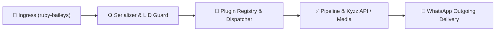

<div align="center">

# 🌸 RUBBY MULTI DEVICE 🌸
### *A lightweight, modular, and high-performance WhatsApp Multi-Device automation bot.*
**By Kyuu • Powered by `ruby-baileys@1.5.17` • Node.js ESM**

<br/>

[](https://github.com/KyuuX444/Rubby-MD)
[](https://api.kyzzz.xyz)
[](https://whatsapp.com/channel/0029VbDXYlKDJ6H1D7Dm0f13)
[](https://youtube.com/@MommyKyuu)

[](LICENSE)
[](https://nodejs.org)
[](https://github.com/KyuuX444)
[](plugins/)

</div>

---

## 1. Project Overview

**Rubby Multi Device** adalah framework bot WhatsApp berbasis arsitektur **Node.js ES Modules (ESM)** murni yang ditenagai oleh official library `ruby-baileys@1.5.17`.

Dirancang dari fondasi modular dengan fokus pada:
- **Performa Ringan & Cepat**: Mengeliminasi overhead runtime yang tidak diperlukan dengan pemanfaatan streaming buffer asli dan memori heap terisolasi.
- **Sistem Hot Reloading Realtime**: Registrasi, perubahan, dan penambahan plugin langsung termuat secara instan tanpa perlu mematikan atau me-restart bot.
- **Dukungan Media Komprehensif**: Generator canvas vector SVG cyberpunk, konversi audio effect 21-in-1, image transformation AI, dan multi-platform media downloader.
- **Arsitektur Socket Bersih**: Handler socket terpusat dengan helper terintegrasi (`decodeJid`, `sendText`, `sendButtons`, deduplikasi command anti-double execution).

---

## 2. Key Features

```
┌─────────────────────────────────────────────────────────────────────────────┐
│                       MODULAR FEATURE CAPABILITIES                          │
├──────────────────────────────┬──────────────────────────────────────────────┤
│ ⚡ Engine & Architecture     │ Node.js ESM • ruby-baileys@1.5.17 • Hot Reload│
│ 🎨 Canvas & Visual Maker     │ Brat Animated • E-KTP • Fake Call • Quotes   │
│ 📊 Telemetry HUD Monitor     │ Sci-Fi Cyberpunk Vector Card (Sharp Render) │
│ 🎵 Modular Audio Effects     │ 21 Discrete Effects (Bass, 8D, Echo, Slow)   │
│ 📥 Multi-Platform Downloader │ TikTok, IG, FB, YT, CapCut, MediaFire, PXL   │
│ 🤖 AI Transformation Studio  │ 31 Neural Art Presets (Ghibli, Chibi, Lego) │
│ 🔒 Enterprise Permissions    │ Owner, Premium, Group Admin & Anti-Double    │
│ 💾 Autonomous Backup Engine  │ Full Codebase ZIP Dispatch directly to Owner │
└──────────────────────────────┴──────────────────────────────────────────────┘
```

### Ikhtisar Kategori Perintah (Highlights):

- **📥 Downloader**: Multi-platform media saver (TikTok, Instagram, Facebook, YouTube, CapCut, MediaFire, Pixeldrain).
- **🎨 Maker & Canvas**: Brat generator dinamis (teks/video/warna), sertifikat, fake payment (Dana, Gopay, Ovo), & mockup sosial media.
- **🎵 Audio Transformer**: 21+ efek DSP audio terisolasi (bass, 8d, echo, nightcore, slow, robot) dan anime/dracin TTS.
- **🤖 AI Image Studio**: 31 preset transformasi gambar bertenaga Kyzz API (ghibli, chibi, lego, anime, roblox).
- **👥 Group Automation**: Sistem sambutan dinamis (welcome/goodbye canvas generator) dan administrasi grup lengkap.
- **🔍 Search & Stalker**: Pencarian lirik, resep, pinterest, spotify, serta profile stalker (IG, TikTok, Roblox, Telegram).
- **🛠️ Tools & Utility**: Exif sticker maker, media converter, inspect ID channel, view-once retriever (RVO/SVO), dan URL shortener.
- **👑 Owner Control**: Manajemen bot realtime, switch mode (`public`/`self`), hot-toggle plugin, evaluasi kode, & auto backup ZIP.

---

## 3. Technology Stack

| Komponen | Teknologi | Keterangan |
| :--- | :--- | :--- |
| **Runtime Environment** | Node.js (>= 18.0.0, ESM) | Native ES Module (`"type": "module"`) |
| **WhatsApp Protocol Engine** | `ruby-baileys@1.5.17` | Multi-Device WebSocket Client |
| **Image & Canvas Processing** | `sharp@^0.35.5` | Pipeline kompresi JPEG/PNG & SVG Vector Renderer |
| **Media Stream Processor** | `fluent-ffmpeg@^2.1.3` | Konversi audio effect, filter, dan video bitrate |
| **Network & HTTP Client** | `axios@^1.20.0` | API resolver dengan timeout guard & stream buffers |
| **Archive Compressor** | `jszip@^3.10.2` | Engine kompresi ZIP otomatis untuk sistem backup |
| **Structured Logger** | `pino@^9.6.0` | Silent internal logger terintegrasi custom cute console |
| **Web Scraper** | `cheerio@^1.2.0` | Parser markup DOM untuk ekstraksi metadata media |

---

## 4. Architecture & Workflow



---

## 5. System Requirements

- **Operating System**: Linux (Ubuntu 20.04+, Debian 11+, Alpine) / macOS / Windows WSL2.
- **Node.js**: Versi `>= 18.0.0` (Direkomendasikan Node.js v20.x atau v22.x LTS).
- **Package Manager**: `npm` (bawaan Node.js) atau `pnpm`.
- **System Utilities**: `ffmpeg` (diperlukan untuk fitur pemrosesan audio & convert sticker gif).

---

## 6. Installation Guide

### 1. Clone Repository

```bash
git clone https://github.com/KyuuX444/Rubby-Multi-Device.git
cd Rubby-Multi-Device
```

### 2. Install Dependencies

```bash
npm install
```

### 3. Konfigurasi Bot

Buka berkas `setting.js` dan sesuaikan variabel konfigurasi sesuai kebutuhan:

```javascript
// setting.js
global.botName = 'Rubby Multi Device'
global.owner = ['628xxxxxxxxxx']           // Nomor WhatsApp Owner (tanpa tanda + atau spasi)
global.mode = 'public'                      // Mode operasional: 'public' atau 'self'
global.noBot = '628xxxxxxxxxx'              // Nomor bot untuk pairing code
global.customPairingCode = 'RUBBYMD1'       // Custom 8-karakter pairing code (opsional)
global.botVersion = '1.0.0'
global.botCreator = 'Kyuu'
global.packname = 'Rubby Multi Device'
global.author = 'Kyuu'
global.thumb = 'media/thumb.jpg'
global.website = 'https://api.kyzzz.xyz'

global.APIs = {
  kyzz: 'https://api.kyzzz.xyz'
}

global.APIKeys = {
  'https://api.kyzzz.xyz': 'YOUR_APIKEY_HERE'
}

global.API = (name, path = '/', query = {}, apikeyqueryname) => {
  const baseUrl = name in global.APIs ? global.APIs[name] : name
  const q = { ...query }
  if (apikeyqueryname) {
    const key = global.APIKeys[baseUrl] || global.APIKeys[name]
    if (key) q[apikeyqueryname] = key
  }
  const search = new URLSearchParams(q).toString()
  return baseUrl + path + (search ? '?' + search : '')
}
```

---

## 7. Authentication & Pairing Code

Rubby Multi Device mendukung koneksi tanpa scan QR menggunakan **Pairing Code 8 Karakter**:

1. Pastikan nomor WhatsApp pada `global.noBot` di `setting.js` telah terisi.
2. Jalankan bot via terminal (`npm start`).
3. Bot akan menampilkan banner Pairing Code di terminal console:
   ```text
   ╭─── ୨୧ RUBBY MULTI DEVICE ୨୧ ───╮
   │ ૮₍˶ᵔ ᵕ ᵔ˶₎ა whatsapp pairing!
   ╰────────────────────────────────╯
   
   ୨ৎ  PAIRING CODE
   │
   ├─ ♡ Number       : 628xxxxxxxxxx
   ├─ ♡ Pairing Code : RUBB-YMD1
   ├─ ♡ Status       : waiting for confirmation
   └─ ♡ Instruction  : Link with phone number in WhatsApp
   ```
4. Buka **WhatsApp** di smartphone > **Perangkat Tertaut (Linked Devices)** > **Tautkan dengan nomor telepon**.
5. Masukkan 8 digit kode yang tertera di terminal.
6. Kredensial sesi otomatis tersimpan di folder `session/`.

---

## 8. Running the Application

### Mode Development / Console Biasa:

```bash
npm start
```

### Mode Production dengan Process Manager (PM2):

```bash
# Menjalankan bot di background
pm2 start main.js --name "rubby-md"

# Memeriksa status & log realtime
pm2 status
pm2 logs rubby-md
```

---

## 9. Actual Project Directory Structure

```text
Rubby-Multi-Device/
├── main.js                     # Core Application & WebSocket Orchestrator
├── handler.js                  # Central Message Dispatcher & Middleware Guard
├── setting.js                  # Global Bot Settings & API Resolver
├── package.json                # Project Manifest & ESM Configuration
├── README.md                   # Documentation Center
├── media/
│   └── thumb.jpg               # Default Global Thumbnail Asset
├── tmp/                        # Temporary Processing Buffers (Auto Cleaned)
├── database/
│   ├── disabled_plugins.json   # Disabled Plugins State Storage
│   ├── groups.json             # Group Welcome/Goodbye & Customization Config
│   └── premium.json            # Premium User Registry
├── lib/
│   ├── exif.js                 # Pure WebP EXIF & VP8X Metadata Muxer
│   ├── logger.js               # Cute Box Console Telemetry & Color Logger
│   ├── message.js              # Custom Baileys Socket Helpers Binding
│   ├── plugins.js              # Dynamic Plugin Registry & Hot Watcher
│   ├── serializer.js           # Message Deserializer, LID Mapping & Parser
│   └── utils.js                # Normalization, Permission & String Helpers
├── scrape/
│   └── ephoto.js               # Ephoto Scraping Utility
└── plugins/                    # 250+ Modular Plugins
    ├── -/                      # Special Non-Prefixed Direct Catchers
    ├── ai-image/               # 31 Neural AI Image Styles
    ├── asupan/                 # 10 TikTok Girl Random Video Handlers
    ├── audio/                  # 21 Modular Audio Effects + 3 Audio Tools
    ├── cewerandom/             # 15 Aesthetic Girl Photo Fetchers
    ├── convert/                # Media Format Converters (Sticker, Image, Video, VN)
    ├── downloader/             # Multi-Platform Downloaders (TikTok, IG, FB, YT, etc.)
    ├── ephoto/                 # 15 Ephoto Text Effect Generators
    ├── group/                  # 15 Group Administration & Automation Handlers
    ├── islamic/                # 8 Islamic Features (Surah, Prayer Schedule, Asmaul Husna)
    ├── main/                   # Core Commands (Menu, Ping HUD, Runtime, Total Fitur)
    ├── maker/                  # 31 Canvas & Brat Generator Presets
    ├── nsfw/                   # 31 NSFW Anime & Hentai Handlers
    ├── owner/                  # 20 Owner Administration Tools & Backup Engine
    ├── search/                 # 13 Online Multimedia Search Handlers
    ├── stalker/                # 12 Social Media & Profile Stalkers
    └── tools/                  # 6 Utility Tools (Tourl, RVO, SVO, CekID, Get)
```

---

## 10. Plugin Development Guide

Sistem plugin Rubby Multi Device berbasis **ES Modules (ESM)** murni dengan dukungan **Hot-Reload** otomatis tanpa perlu restart bot.

### 1. Template Dasar Perintah Teks (`plugins/main/hello.js`)

```javascript
const handler = async (m, { conn, args, text, usedPrefix, command, reply }) => {
  const target = m.mentionedJid?.[0] || m.sender
  await reply(`🌸 Halo @${target.split('@')[0]}! Selamat datang di *${global.botName}*.`, {
    mentions: [target]
  })
}

handler.help = ['hello']              // Teks yang muncul pada menu (.menu)
handler.tags = ['main']               // Kategori menu
handler.command = ['hello', 'hi']     // Trigger perintah (string, array, atau RegExp)

export default handler
```

---

### 2. Template Plugin API & Media (`plugins/downloader/example.js`)

```javascript
import axios from 'axios'

const handler = async (m, { conn, text, usedPrefix, command, reply }) => {
  if (!text) return reply(`⚠️ *Format Salah!*\n\nContoh:\n*${usedPrefix + command}* https://vt.tiktok.com/xxxx/`)

  await reply(global.mess.wait)

  try {
    const apiUrl = global.API('kyzz', '/api/downloader/tiktok', { url: text }, 'apikey')
    const { data } = await axios.get(apiUrl, { timeout: 30000 })

    if (!data.status) return reply(`❌ ${data.message || 'Gagal mengunduh media.'}`)

    await conn.sendMessage(m.chat, {
      video: { url: data.result.video },
      caption: `🎬 *Judul:* ${data.result.title}\n👤 *Author:* ${data.result.author}`
    }, { quoted: m })
  } catch (err) {
    await reply(`❌ Terjadi kesalahan: ${err.message}`)
  }
}

handler.help = ['tiktok <url>']
handler.tags = ['downloader']
handler.command = /^(tiktok|tt|ttdl)$/i
handler.limit = true                  // Memerlukan limit

export default handler
```

---

### 3. Parameter Handler & Permission Flags Lengkap

```javascript
// Parameter yang tersedia di handler:
// async (m, { conn, sock, args, text, usedPrefix, command, registry, reply }) => {}

// Flag Perizinan (Opsional):
handler.owner = false      // Hanya dapat digunakan oleh Owner
handler.premium = false    // Hanya untuk Pengguna Premium
handler.group = false      // Hanya bisa di dalam Group Chat
handler.private = false    // Hanya bisa di Private Chat (PC)
handler.admin = false      // Pengirim pesan wajib Admin Grup
handler.botAdmin = false   // Bot wajib menjadi Admin Grup
handler.limit = false      // Mengurangi limit pengguna
handler.disabled = false   // Menonaktifkan plugin secara manual
```

---

## 11. Troubleshooting Guide

| Kendala / Error | Kemungkinan Penyebab | Solusi |
| :--- | :--- | :--- |
| **QR / Pairing Code tidak muncul** | Format nomor pada `global.noBot` salah | Pastikan nomor berformat internasional tanpa simbol (contoh: `6283150850721`). |
| **`ERR_REQUIRE_ESM`** | Menggunakan sintaks `require()` pada environment ESM | Gunakan `import ... from '...'` atau dynamic import `await import(...)`. |
| **Session Disconnected (401 / Logged Out)** | Sesi telah dikeluarkan dari perangkat WhatsApp | Hapus isi folder `session/` lalu tautkan kembali via pairing code baru. |
| **Gagal Render Audio Effects** | Binary FFmpeg belum terpasang di server | Jalankan `sudo apt install ffmpeg` pada sistem Linux/Ubuntu. |
| **`EACCES` atau Permission Error pada `tmp/`** | Hak akses folder terbatasi | Jalankan `chmod -R 755 tmp/ database/ session/`. |

---

## 12. Security & Best Practices

1. **Proteksi Folder Session**: Folder `session/` berisi kredensial enkripsi privat WhatsApp Anda (`creds.json`). **Jangan pernah** membagikan, mengunggah ke GitHub publik, atau mengirimkan folder ini ke pihak lain.
2. **Kerahasiaan API Key**: Simpan API Key pihak ketiga pada `setting.js` secara privat dan hindari mempublikasikan repository berisi kredensial produksi.
3. **Penyaringan Pesan Sensitif**: Rubby MD secara default mengabaikan siaran broadcast dan newsletter untuk menjaga stabilitas memori server.
4. **Bypass Eval Execution**: Fitur evaluasi kode (`>`, `=>`, `$`) dibatasi secara ketat hanya dapat dieksekusi oleh nomor yang terdaftar di `global.owner`.

---

## 13. About the Developer

<p align="left">
  <strong>Kyuu</strong> — <em>Creator & Lead Developer of Rubby Multi Device</em><br/>
  Fokus pada pengembangan otomasi WhatsApp modern, arsitektur microservices, dan ekosistem API modular.
</p>

### Official Developer Channels:
- **GitHub**: [github.com/KyuuX444](https://github.com/KyuuX444)
- **Official API Portal**: [api.kyzzz.xyz](https://api.kyzzz.xyz)
- **YouTube Channel**: [MommyKyuu](https://youtube.com/@MommyKyuu)
- **WhatsApp Announcement Channel**: [Rubby Official Updates](https://whatsapp.com/channel/0029VbDXYlKDJ6H1D7Dm0f13)

---

## 14. License & Attribution

Proyek ini dirilis dan dikembangkan di bawah lisensi **ISC**.

```text
Copyright (c) 2026 Kyuu

Permission to use, copy, modify, and/or distribute this software for any
purpose with or without fee is hereby granted, provided that the above
copyright notice and this permission notice appear in all copies.
```

### Acknowledgements & Credits:
- **Allah SWT.** — The Creator of Everything.
- **Ruby-Baileys** — Modern WhatsApp Multi-Device Protocol Library.
- **Sharp & Libvips** — High-Performance Image & Vector Processing.
- **Kyzz API** — Unified Multimedia & AI Processing Endpoints.
- Seluruh kontributor, pengguna, dan komunitas pengembang WhatsApp bot.

---

<div align="center">
  <sub>Made with 💜 by <b>Kyuu</b> • Rubby Multi Device • 2026</sub>
</div>
